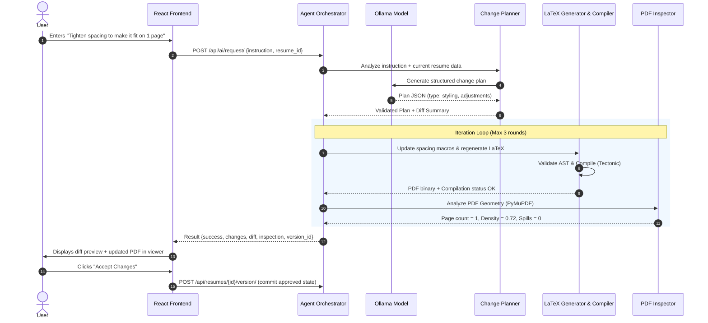

# CVstart System Architecture

## 1. Architectural Philosophy

CVstart is designed around five foundational architectural principles:

1. **Local-First & Zero Telemetry:** User resumes contain deeply sensitive personal, professional, and contact information. All model inference occurs locally via [Ollama](https://ollama.ai/), all LaTeX compilation executes via a sandboxed local compiler ([Tectonic](https://tectonic-typesetting.github.io/)), and all state is persisted to a local SQLite database. No external APIs or telemetry are invoked.
2. **Structured Data as the Single Source of Truth:** LaTeX source code is a *derived presentation artifact*, never the sole source of truth for resume data. Resumes are stored as strongly typed, schema-validated JSON records. Edits are applied to structured data first, which is then rendered through versioned, ATS-optimized LaTeX templates.
3. **Deterministic Agent Orchestration:** Rather than granting a language model arbitrary code execution or unconstrained tool access, CVstart uses a deterministic Django orchestrator. The AI acts as a planner that submits structured change proposals and diagnostics queries through 13 strictly typed application tools.
4. **Agentic Visual & Geometric Inspection:** Traditional AI resume generators simply output LaTeX and assume it renders properly. CVstart features a closed-loop compilation and inspection pipeline: LaTeX is compiled, PyMuPDF analyzes text bounding boxes, density, margins, and page spills, and the agent performs targeted layout corrections bounded to a maximum of 3 iterations.
5. **Auditable Human-in-the-Loop Reviews:** Content changes (job titles, responsibilities, skills) require explicit user diff approval in the UI before being committed. Pure layout/formatting adjustments can be auto-approved based on user configuration, preserving factual integrity at all times.

---

## 2. High-Level Component Architecture

```text
┌────────────────────────────────────────────────────────────────────────┐
│                        User Browser (Desktop)                          │
│                                                                        │
│   ┌────────────────────────────────────────────────────────────────┐   │
│   │                 React 19 + TypeScript SPA                      │   │
│   │  • Structured Form Editor (Tabs: Bio, Exp, Proj, Edu, Skills)  │   │
│   │  • Interactive PDF Viewer with Geometry Bounding-Box Overlay   │   │
│   │  • Monaco/CodeMirror-style LaTeX Source Editor with Line Nos   │   │
│   │  • AI Assistant Panel: Chat, Diff Review, Iteration Tracer     │   │
│   └────────────────────────────────────────────────────────────────┘   │
└────────────────────────────────────┬───────────────────────────────────┘
                                     │ HTTP / REST API (port 9999)
┌────────────────────────────────────▼───────────────────────────────────┐
│                    Django 6.1 Application Server                       │
│                                                                        │
│   ┌────────────────────────────────────────────────────────────────┐   │
│   │                      Django REST Framework                     │   │
│   │  /api/resumes/     /api/latex/     /api/ai/     /api/system/   │   │
│   └───────┬───────────────────────────────┬────────────────┬───────┘   │
│           │                               │                │           │
│   ┌───────▼─────────────┐   ┌─────────────▼────────────┐   │           │
│   │  Resumes App & ORM  │   │  AI Agent Orchestrator   │   │           │
│   │  • Resume Model     │   │  • Change Planner        │   │           │
│   │  • ResumeVersion    │   │  • Tool Registry (13)    │   │           │
│   │  • Pydantic Schema  │   │  • Bounded Iteration (3) │   │           │
│   └───────┬─────────────┘   └─────────────┬────────────┘   │           │
│           │ SQLite                        │ HTTP (11434)   │           │
│   ┌───────▼─────────────┐   ┌─────────────▼────────────┐   │           │
│   │  SQLite Database    │   │      Ollama Engine       │   │           │
│   │  (cvstart.sqlite3)  │   │  (llama3.2, mistral...)  │   │           │
│   └─────────────────────┘   └──────────────────────────┘   │           │
│                                                            │           │
│   ┌────────────────────────────────────────────────────────▼───────┐   │
│   │             LaTeX & Compilation Subsystem                      │   │
│   │  • Safe Escaper: \$, \%, \&, \#, \_, \{, \}, \~, \^, URLs      │   │
│   │  • Generator: modern_technical, minimalist, executive          │   │
│   │  • AST / Command Validator: Blocks \write18, input, shell      │   │
│   │  • Sandboxed Tectonic Runner: Subprocess with strict timeouts  │   │
│   └───────────────────────────────┬────────────────────────────────┘   │
│                                   │ Compiled PDF                       │
│   ┌───────────────────────────────▼────────────────────────────────┐   │
│   │            Inspection & Diagnostics Subsystem                  │   │
│   │  • PyMuPDF Geometry Analyzer: Bounding boxes, margins, density │   │
│   │  • Page Renderer: Multi-page high-DPI PNGs for UI / Vision     │   │
│   │  • Layout Classifier: Page spill & cramped section detection   │   │
│   └────────────────────────────────────────────────────────────────┘   │
└────────────────────────────────────────────────────────────────────────┘
```

---

## 3. Subsystem Breakdown

### 3.1 Frontend Subsystem (`frontend/src/`)

- **State Management & Routing:** Single-Page Application built with Vite and TypeScript. Active resume state, unsaved changes dirty flags, compiler diagnostics, and AI assistant dialogues are managed through centralized React hooks.
- **Form Editor (`components/editor/EditorView.tsx`):**
  - Section-based tabs (Personal Info, Summary, Work Experience, Projects, Education, Skills, Custom Sections).
  - Dynamic repeatable array controls for adding, editing, reordering, and deleting entries.
- **LaTeX Source Editor (`components/editor/LatexEditor.tsx`):**
  - Full syntax-highlighted editor with line numbers, copy-to-clipboard, export `.tex`, and live syntax validation against security rules.
- **PDF Viewer & Inspection Drawer (`components/preview/PdfViewer.tsx`):**
  - Zoom controls (fit-to-width, fit-to-page, 50% to 200%).
  - Real-time compilation status badge (Current, Outdated, Compiling, Failed).
  - Inspection Drawer detailing exact page counts, margins, text density, and detected layout warnings.
- **AI Assistant Drawer (`components/assistant/AiAssistantPanel.tsx`):**
  - Natural language chat with quick action chips.
  - Interactive diff review showing added, removed, and modified fields with **Accept Changes** and **Reject Changes** buttons.
  - Multi-step iteration trace displaying the compile-inspect-correct feedback loop in real time.

### 3.2 Backend & Data Persistence Subsystem (`backend/apps/resumes/`)

- **Resume Model:**
  - `id`: UUID primary key.
  - `name`: Human-readable label.
  - `data`: Serialized JSON matching `StructuredResumeSchema`.
  - `latex_source`: The latest rendered or manually edited LaTeX code.
  - `pdf_path`: Relative filesystem reference to the compiled PDF in `workspace/builds/`.
  - `selected_template`: Template identifier (`modern_technical`, `minimalist`, `executive`).
  - `page_size`: Paper geometry (`letter`, `a4`).
  - `selected_model`: Ollama model associated with the resume.
- **ResumeVersion Model:**
  - Immutable version history for checkpointing and instant rollback to any previous good state.
- **Pydantic Validation (`backend/apps/resumes/schemas.py`):**
  - Comprehensive schemas for `PersonalInfo`, `ExperienceItem`, `ProjectItem`, `EducationItem`, `SkillGroup`, and `CustomSection`.

### 3.3 LaTeX Security, Escaping & Compilation (`backend/apps/latex/`)

- **Escaping Engine (`escaper.py`):**
  - Sanitizes user input across 10+ LaTeX special characters (`#`, `$`, `%`, `&`, `_`, `{`, `}`, `~`, `^`, `\`).
  - Sanitizes URLs to prevent macro injection via `\href` and `\url`.
- **Template Generator (`generator.py`):**
  - Renders structured data into clean, modular LaTeX.
  - Supports configurable spacing macros (`\cvsectionspacing`, `\cvitemspacing`).
- **Safety Validator (`validator.py`):**
  - Inspects AST and raw tokens. Disallows `\write18`, `\immediate`, `\input`, `\include`, `\openin`, `\openout`, `\catcode`, `\csname`, and environment overrides.
- **Sandboxed Compiler (`compiler.py`):**
  - Invokes `tectonic.exe` in a dedicated ephemeral temporary directory (`tempfile.mkdtemp()`).
  - Enforces a 30-second timeout, memory bounds, and strictly captures stdout/stderr.
  - Parses LaTeX error logs into line-numbered diagnostic objects (`file`, `line`, `message`, `error_type`).

### 3.4 Inspection Engine (`backend/apps/inspection/`)

- **Objective Geometry Analyzer (`pdf_analyzer.py`):**
  - Loads compiled PDF using PyMuPDF (`fitz`).
  - Extracts page dimensions (points and inches), line heights, margins, and text block bounding boxes `(x0, y0, x1, y1)`.
  - Computes content density (text area / total page area).
  - Identifies single-line overflow and orphan page spills (e.g., page 2 containing under 10% content).
- **Page Renderer (`page_renderer.py`):**
  - Renders PDF pages to 150 DPI PNG images and base64 payloads for inspection overlays and vision models.

### 3.5 Agentic AI Orchestrator & Tool Registry (`backend/apps/ai/`)

- **Model Client (`ollama_client.py`):**
  - Dynamically discovers installed models via `/api/tags`.
  - Identifies model parameter counts, quantization levels, and vision capabilities.
- **Change Planner (`change_planner.py`):**
  - Classifies natural language prompts into `content`, `styling`, `structure`, `explanation`, or `compilation`.
  - Produces structured diffs comparing current data against target modifications.
  - Factual integrity guardrail checks whether novel employer names, degrees, or skills are being hallucinated.
- **Tool Registry (`tool_registry.py`):**
  - Defines 13 isolated application tools:
    `get_resume_data`, `plan_resume_changes`, `update_resume_data`, `generate_latex`,
    `validate_latex`, `compile_latex`, `render_pdf`, `inspect_pdf`, `inspect_layout`,
    `edit_latex`, `get_compile_diagnostics`, `save_resume_version`, `export_resume`.
- **Bounded Iteration Loop (`orchestrator.py`):**
  - Maximum iteration limit = 3.
  - Automatically attempts layout parameter adjustments (e.g., margins, section spacing) when an unexpected 2nd page spill is detected.

---

## 4. Sequence: Natural Language Edit & Compile Loop


